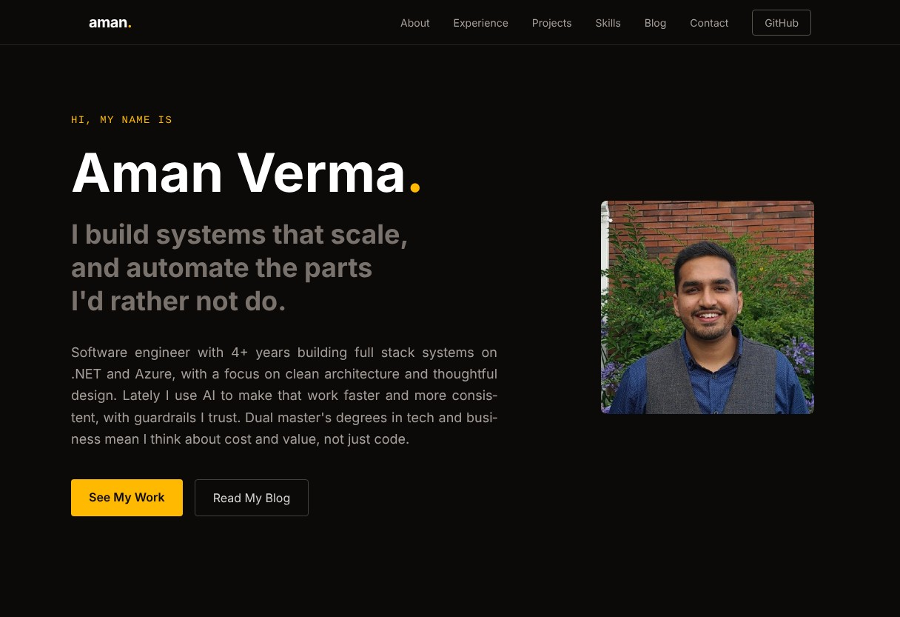

# aman-vr.vercel.app

Personal portfolio website built with React and Tailwind CSS. Deployed on Vercel.



Live: [aman-vr.vercel.app](https://aman-vr.vercel.app)

## Tech Stack

- [React](https://react.dev/) — UI framework
- [Vite](https://vitejs.dev/) — build tool
- [Tailwind CSS v4](https://tailwindcss.com/) — styling
- [Framer Motion](https://www.framer.com/motion/) — animations
- [react-icons](https://react-icons.github.io/react-icons/) — icons
- [React Router](https://reactrouter.com/) — routing for blog posts
- [react-markdown](https://github.com/remarkjs/react-markdown) + [Tailwind Typography](https://github.com/tailwindlabs/tailwindcss-typography) — post rendering

## Project Structure

```
scripts/
└── og-pages.mjs         # Post-build: per-post HTML with Open Graph tags for link previews
public/
└── images/blog/<slug>/  # Post diagrams and the 1200x630 OG image
src/
├── data/
│   ├── profile.js       # All personal content lives here
│   └── posts.js         # Blog post metadata (title, date, tags, OG image)
├── content/
│   ├── posts.js         # Loads post bodies
│   └── posts/<slug>.md  # Blog post bodies in Markdown
├── hooks/
│   └── useDocumentMeta.js
├── pages/
│   ├── HomePage.jsx     # The single-page portfolio
│   ├── BlogPostPage.jsx # /blog/:slug
│   └── NotFoundPage.jsx
├── components/
│   ├── Navbar.jsx
│   ├── Hero.jsx
│   ├── About.jsx
│   ├── Skills.jsx
│   ├── Experience.jsx
│   ├── Projects.jsx
│   ├── Blog.jsx
│   ├── Contact.jsx
│   └── Footer.jsx
├── App.jsx
└── index.css
```

## Customising for Someone Else

All personal content is centralised in `src/data/profile.js`. To use this as a template:

1. Fork or clone the repo
2. Update `src/data/profile.js` with new personal details
3. Set `VITE_APP_URL` in `.env` to your deployed URL (used for OG meta tags)
4. Drop your CV as `public/AmanVerma-CV.pdf` to enable the Resume button in the navbar
5. Deploy to Vercel

## Getting Started

```bash
# Install dependencies
npm install

# Start dev server
npm run dev

# Build for production
npm run build
```

## Writing a Blog Post

1. Add the body as `src/content/posts/<slug>.md` (no H1; the title comes from metadata)
2. Add an entry at the top of `src/data/posts.js` with the same `slug`
3. Put diagrams and a 1200x630 `og.png` in `public/images/blog/<slug>/`
4. `npm run build` also writes `dist/blog/<slug>.html` with the post's Open Graph tags, so LinkedIn and other crawlers (which don't run JavaScript) show the right preview
5. After deploying, check the preview with [LinkedIn Post Inspector](https://www.linkedin.com/post-inspector/)

`vercel.json` serves those generated pages through `cleanUrls` and falls back to the SPA for every other route.

## Deployment

Deployed on [Vercel](https://vercel.com). Every push to `main` triggers an automatic deployment.

## Sections

| Section           | Description                                          |
| ----------------- | ---------------------------------------------------- |
| Hero              | Name, tagline, bio, CTA buttons                      |
| About             | Bio paragraphs, interests, education                 |
| Skills            | Certifications, tech stack, publications             |
| Experience        | Work history timeline                                |
| Projects          | Featured projects with tech tags and links           |
| Blog              | Post cards linking to /blog/:slug                    |
| Contact           | Email CTA, social links                              |
